<p align="center">
  <picture>
    <source media="(prefers-color-scheme: dark)" srcset="docs/assets/banner-dark.svg">
    <source media="(prefers-color-scheme: light)" srcset="docs/assets/banner-light.svg">
    
  </picture>
</p>

<p align="center">
  A free, open-source guide addon for <b>World of Warcraft: Forever</b>: leveling routes for every start, found by simulation and written step by step.
</p>

<p align="center">
  <a href="LICENSE"></a>
  
  
  <a href="https://github.com/fitzforge/polestar/actions/workflows/ci.yml"></a>
</p>

<p align="center">
  <a href="#what-it-is">What it is</a> ·
  <a href="#a-look-inside">A look inside</a> ·
  <a href="#features">Features</a> ·
  <a href="#how-the-routes-are-made">How the routes are made</a> ·
  <a href="#install">Install</a> ·
  <a href="#building-from-source">Building from source</a> ·
  <a href="#contributing">Contributing</a> ·
  <a href="#data-and-licensing">Data and licensing</a>
</p>

## What it is

Polestar is one addon for the whole of WoW: Forever. It carries 164 guides:
63 leveling guides that take both factions from 1 to 60 from every race's
starting zone (Zephras Isle for the Skyborne included), the twelve
professions from 1 to 300, 17 reputations, 7 exploration guides, the Legacy
challenges and 64 collectible guides, one per mount and per pet. Around the
guides it adds a 3D waypoint arrow with a travel planner, quest markers on the
map, an upgrade indicator on item tooltips, a search for where any item, mount
or pet comes from, a dungeon quest journal, rare alerts and the quality-of-life
helpers a long leveling session needs.

The leveling routes are not hand-picked. A simulator models every quest
Forever offers a faction, plays millions of complete 1-60 routes for each
start, and keeps the one that reaches 60 soonest under its model; the guides
are written from that route and scored under the same model
([How the routes are made](#how-the-routes-are-made)).

> [!NOTE]
> **Beta.** Every guide compiles, lints and plays to the end in a simulator
> for every race and class it serves, but nothing has been play-tested on
> Forever yet. Forever's new 30-60 content (Riverglades, Shen'dralas, Mount
> Hyjal) is not in any data yet; the routes take it in at launch.

## A look inside

Every picture below is the addon's real Lua UI, drawn without the game by
`node tools/polestar.js preview` against a stub client with sample guides and
data. None of them contains game art.

<table>
  <tr>
    <td colspan="2" align="center">
      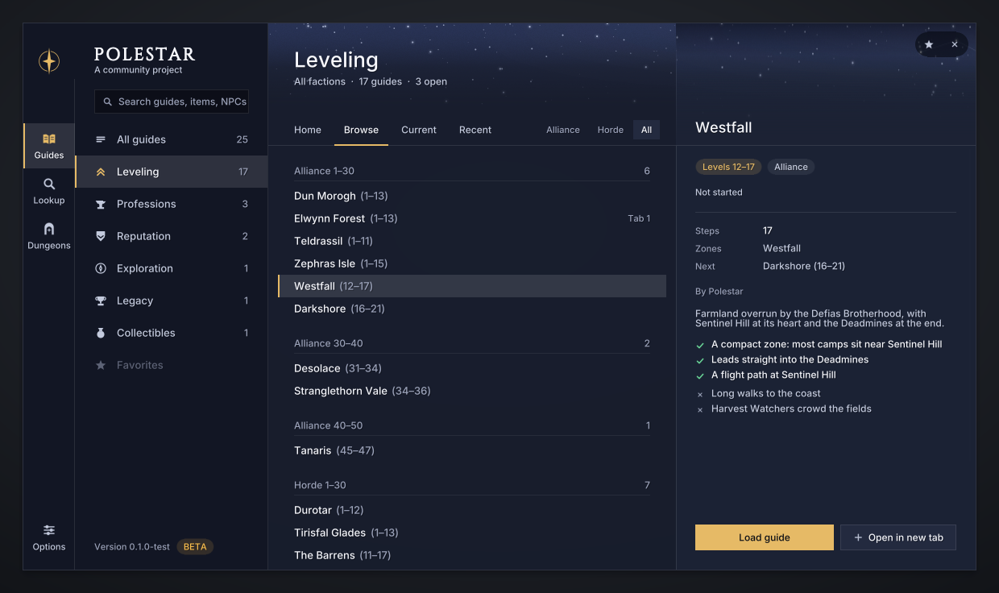
      <br><sub><b>The hub.</b> Guides, Lookup, Dungeons and Rares on one rail, Options at its foot. Here the leveling guides by faction and level band, with the selected guide's details.</sub>
    </td>
  </tr>
  <tr>
    <td width="50%" align="center">
      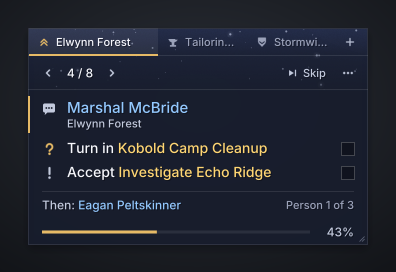
      <br><sub><b>The guide window.</b> In a hub it shows one person at a time, their quests and who comes next.</sub>
    </td>
    <td width="50%" align="center">
      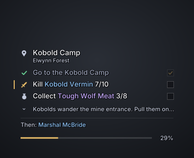
      <br><sub><b>Transparent mode.</b> No ground at all: outlined text straight on the world, the chrome only under the cursor.</sub>
    </td>
  </tr>
  <tr>
    <td width="50%" align="center">
      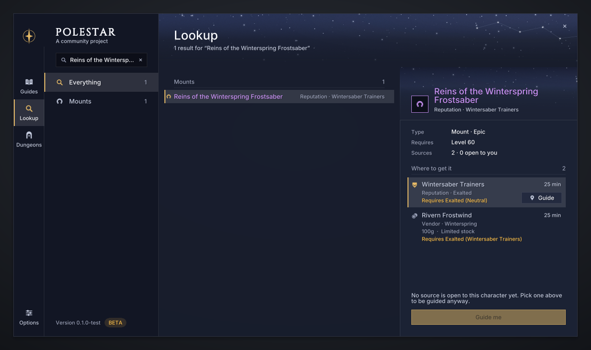
      <br><sub><b>Lookup.</b> Where an item, mount or pet comes from, its sources ranked for your character.</sub>
    </td>
    <td width="50%" align="center">
      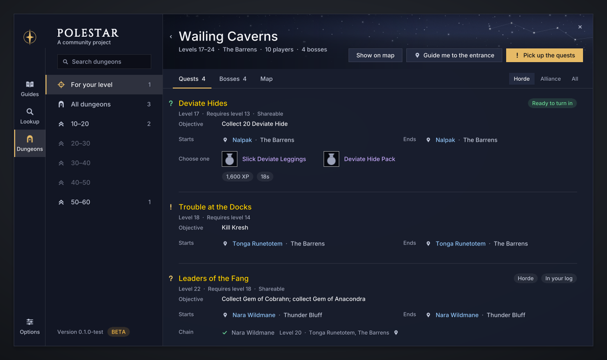
      <br><sub><b>Dungeons.</b> A journal page per dungeon: every quest, its chain and rewards, the bosses and the entrance.</sub>
    </td>
  </tr>
  <tr>
    <td width="50%" align="center">
      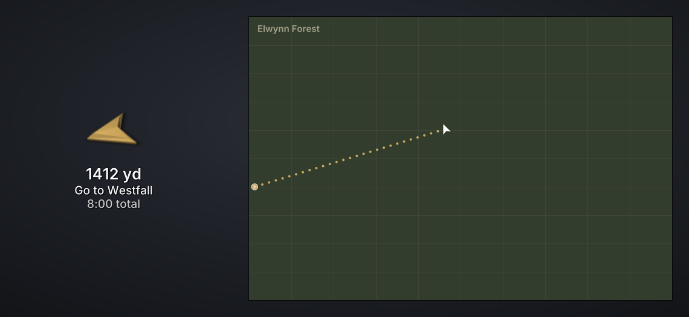
      <br><sub><b>Arrow and route.</b> Each leg captioned on the arrow, trail dots on the map to the next waypoint.</sub>
    </td>
    <td width="50%" align="center">
      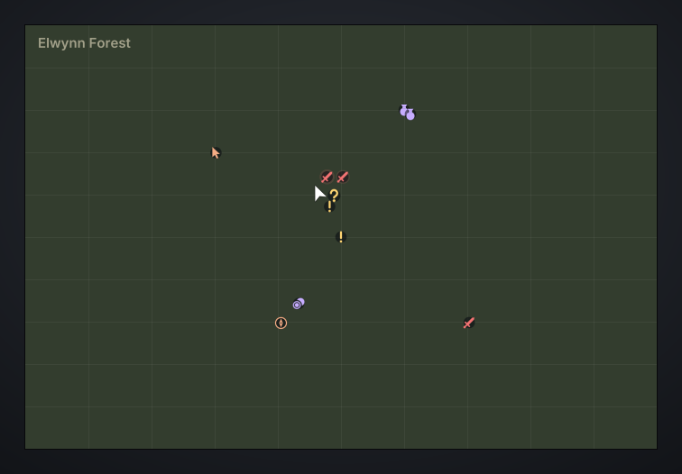
      <br><sub><b>Quest markers.</b> Givers, objectives and turn-ins on the world map, off by default.</sub>
    </td>
  </tr>
  <tr>
    <td width="50%" align="center">
      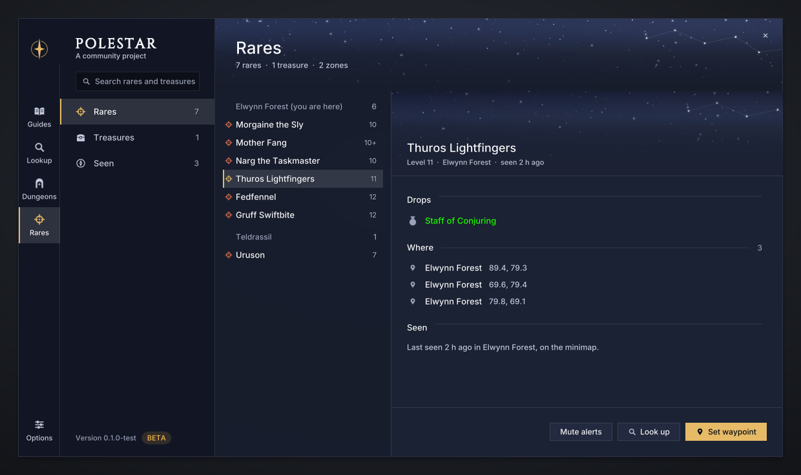
      <br><sub><b>Rares.</b> Rares and treasures by zone with their spawns and signature drop.</sub>
    </td>
    <td width="50%" align="center">
      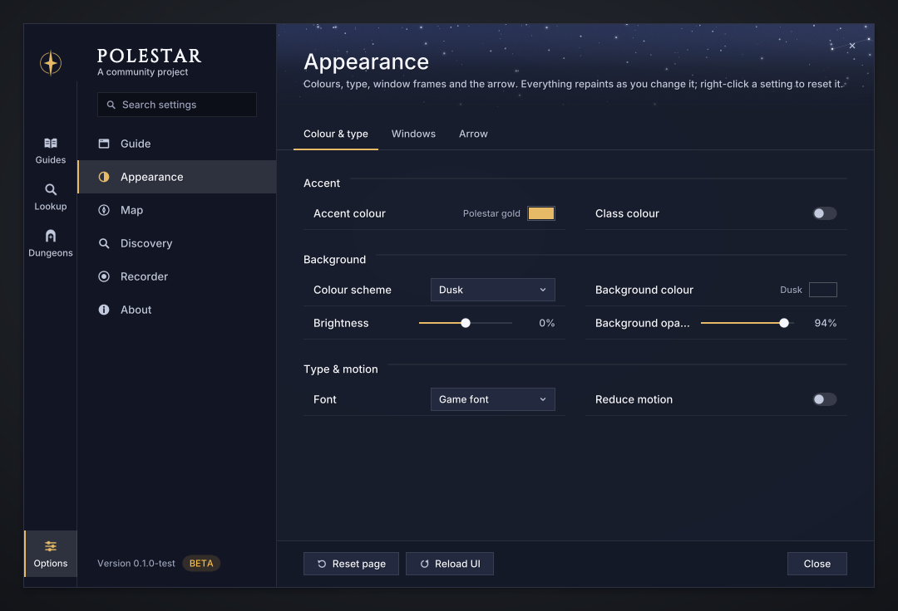
      <br><sub><b>Options.</b> Every setting as one row, applied live; here Appearance.</sub>
    </td>
  </tr>
  <tr>
    <td width="50%" align="center">
      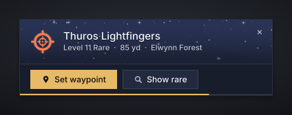
      <br><sub><b>Rare alert.</b> A rare on the minimap, at its distance, one click from the arrow.</sub>
    </td>
    <td width="50%" align="center">
      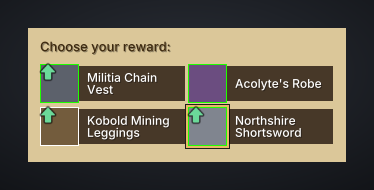
      <br><sub><b>Quest rewards.</b> Upgrades marked on the game's own reward panel, the one to take framed.</sub>
    </td>
  </tr>
  <tr>
    <td colspan="2" align="center">
      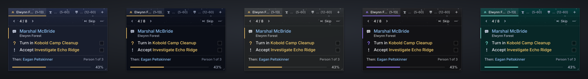
      <br><sub><b>Colour schemes.</b> Dusk (the default), Night, Graphite, EllesmereUI's own when it is installed, and a look of your own.</sub>
    </td>
  </tr>
</table>

More renders, one per state and section, are in [docs/preview](docs/preview).

## Features

### Guides and the engine

- **One person at a time.** In a quest hub the window shows only who to talk
  to now and their quests, then "Then: *next person*" and "Person 2 of 8";
  the arrow points at that person. Counters sit right after each goal ("Kill
  Zhevra Chargers 3/8") and a bar at the foot shows how far into the guide you
  are.
- **Goals check themselves off** as you play: accepted and turned-in quests,
  kills, loot, places reached, trainers visited, skills and reputation. Your
  place in a guide is recomputed from your quest log, so it survives lost
  saved variables.
- **A guide for where you are.** The window opens with a guide suggested for
  your race, class, level and location, and each guide hands over to the
  next one in its chain when you finish it.
- **Tabs.** Up to six guides open at once (a leveling route and a profession,
  say); quests are auto-accepted for all of them.
- **Professions** send you to the nearest trainer, vendor or inn of your own
  faction from where you stand, never into a city of the other faction; a
  goal's cycle button picks another.
- **Class training reminder** every two levels (configurable): the nearest
  trainer of your class, unless your guide is about to take you there.
- **Elite quests are optional.** Leveling routes use only quests a player can
  do alone; a quest that needs an elite appears as an extra marked "optional".

### Navigation

- **A 3D waypoint arrow** points at the current goal, shifting from the
  accent to jade as you arrive, with distance and ETA.
- **The travel planner** uses known flight paths, boats, zeppelins and your
  Hearthstone when they are faster. Each leg has its own caption on the arrow
  ("Fly to Crossroads", "Take the boat to Menethil Harbor", "Hearth to Razor
  Hill").
- **Trail dots** on the world map and the minimap crawl along the route
  between its waypoints (Map options can turn them off).
- **Zone crossings.** With an optional local crossings file, walks between
  zones go through the real tunnels, passes, bridges, gates and lifts, one
  waypoint at a time with its own caption ("Enter Orgrimmar" at the gate), and
  caves are entered at their mouth.
- **`/polestar way <x> <y> [label]`** points the arrow anywhere on the current
  map.

### Quests and the map

- **Quest markers**: givers, objectives and turn-ins on the world map and the
  minimap, with tooltip lines on the mobs and items a quest needs and quest
  levels in the log.
- **Rare and treasure spawns, dungeon entrances, flight masters, docks and
  inns** can mark the map too. Every map icon is off by default and turns on
  under **Map** in the options; the arrow's target, its spawn area and its
  route always show.
- **A world map without fog of war**, with coordinates and zone level ranges.

### Gear advice

- **Upgrade indicator** on item tooltips: by how much an item is an upgrade
  for your spec at your level, from stat weights per spec (detected from your
  talent points) and level band.
- **On the game's reward panel** every choice that is an upgrade gets a green
  arrow and the one to take is framed; with no upgrade, a coin marks the one
  that sells for most. Turn-in goals name the best reward.

### Lookup, Dungeons and Rares

- **Lookup** searches guides, items, mounts, pets, NPCs, quests, zones,
  dungeons and rares, and answers "how do I get that?" with the sources
  ranked for your character. "Guide me" opens the curated guide or builds one
  on the spot. Target or mouse over a player to see their mount and how to get
  it; Alt-click an item link for a guide.
- **Dungeons**: a journal page per dungeon with every quest (where it starts
  and ends, its objective, chain and rewards), the bosses and the entrance.
  "Pick up the quests" builds a guide that collects every quest of the
  dungeon you can take, earlier quests first, on the shortest path from where
  you stand to the entrance.
- **Rares**: rares and treasures by zone with their spawns and signature
  drop, and an alert when one shows up on your minimap, nameplates or target.

Lookup, Dungeons and Rares read the Codex, a data pack built on your own
machine from addons you have installed ([Data and licensing](#data-and-licensing));
it is not part of the release. Without it Lookup still searches the guides,
and each section says what is missing.

### Appearance and UI suites

- **Colour schemes**: Dusk (the default), Night and Graphite, and
  EllesmereUI's own panel colour and accent while it is installed. On top of
  any scheme: your own accent or your class colour, background colour,
  opacity and brightness. Text stays legible whatever you pick: a ground too
  light for its text is darkened until it reads.
- **Windows**: the border, its colour and thickness, the starlit header band
  and the shadow, each on or off; the guide window's style (standard, compact
  or transparent), scale, width and opacity; the menu scale; the arrow's style,
  scale, opacity and colours; reduced motion. Everything applies live,
  without a reload; right-click any setting to reset it.
- **Fonts**: the game's own by default, or Inter, or EllesmereUI's.
- **EllesmereUI**: Polestar follows its accent and font by default through
  its public skinning API, and where its Quality of Life or Friends module
  does the same job as a Polestar toggle, the toggle starts off.

### Quality of life

Quest item, target and Hearthstone buttons; XP per hour and time to level;
selling greys and repairing (optionally from the guild bank first); taking
the best quest reward; instant quest text, single-option gossip and faster
auto-loot; hiding combat error spam; flight map and death helpers, and
releasing at once in battlegrounds. Requests from other players: accept
summons, resurrections and friends' or guildmates' party invitations; decline
other party invitations, guild invitations and duels (friends and guild
excepted). Hold **Shift** to skip auto-accept, auto-turn-in, auto-sell or the
flight helper once, or to answer a request yourself.

### Recorder

`Polestar_Recorder` is an optional companion addon that records your
sessions to improve the routes. It is off until you turn it on (`/lsrec on`,
or Options > Recorder > Start recording) and writes nothing while off.
Recordings replace the Classic Era estimates with Forever facts (quest XP,
NPC and object positions, trainers, flight paths and times), and
`record report` turns them into per-step timings: passes, median and p75
time, XP per hour, time in combat, deaths and travel, then the slowest
steps and detours, the steps to fix first.

### Commands

`/polestar` (or `/pole`) opens the guide window; settings live in
`/polestar options`, grouped by what you came to do: Guide, Appearance, Map,
Questing, Discovery, Quality of Life, Recorder and About, with a search that
finds any setting.

<details>
<summary><b>Every slash command</b></summary>

| Command | What it does |
|---|---|
| `show`, `hide` | Show or hide the guide window |
| `guides` | Open the hub on Guides |
| `options [page]` | Open the settings, optionally on a page |
| `next`, `prev` | Look at the next or previous step (nothing is skipped) |
| `skip` | Skip the step shown, for good (the window offers Undo) |
| `status` | Current guide and step |
| `guide <id>` | Switch to a guide by id |
| `tabs`, `tab <n>`, `close` | List, switch and close guide tabs |
| `path` | Choose where to level next, where a guide offers a choice of route |
| `route` | Show the travel route to the current target |
| `way <x> <y> [label]` | Point the arrow at x y on your current map (no argument clears it) |
| `arrow show\|hide\|reset` | The waypoint arrow (drag it to move it) |
| `reset` | Clear ticks and skips for the current guide |
| `xp` | XP per hour, time to level and level splits |
| `gear [item link]` | Gear advice: the weights in use, or compare an item |
| `instances [clear]` | Instance limits, runs and lockouts |
| `dungeons [name]` | Open Dungeons, or a dungeon's page |
| `lookup [search]` | Open Lookup, optionally searching |
| `mount` | Look up the mount of your target (or mouseover) and how to get it |
| `rares [test]` | Open Rares, or show a sample rare alert |
| `questdb` | Quest database status |
| `debug` | Toggle debug output |

The Recorder has its own: `/lsrec on | off | mark <text> | clear` and a
few more listed by `/lsrec`.

</details>

## How the routes are made

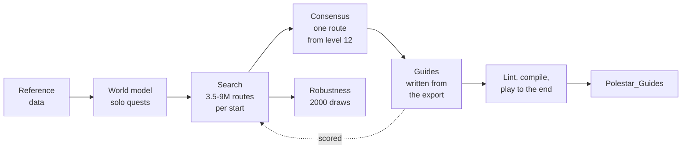

1. **World model.** Every quest the faction can do, with its level,
   prerequisites, givers and enders, and the work its objectives take: kills
   at the mob's spawn clusters, item drops at their recorded rates, objects,
   escorts. Dungeon, raid, PvP and elite quests are filtered out, so a route
   is something one player can do alone.
2. **Search.** For each start (Orc, Tauren, Undead and Skyborne for the
   Horde; Human, Dwarf, Night Elf and Skyborne for the Alliance), randomised
   greedy construction, local search and simulated annealing evaluate
   millions of complete 1-60 routes, restarting until the best route stops
   improving or a cap on evaluated routes is reached.
3. **Route rules.** When routes are compared, grinding counts 2.5 times and
   every move into another zone counts 7.5 minutes, so a route takes a hub's
   quests, does them in one loop and moves on rather than chasing a few
   experience points across the map. Reported hours stay real.
4. **Consensus.** Each start keeps its own route to level 12 (the starting
   zone guides); from there one shared route per faction is searched, so the
   guides join into one chain.
5. **Guides.** The consensus route is exported as skeleton guides, one per
   zone visit, and the guides are written from them by hand. They drop side
   trips for one or two small quests behind a flight, boat, hearth or long
   ride; where that leaves the level short, a step names a camp to grind at
   (with an optional dungeon for the long ones). The finished guides are
   scored under the same model, next to the best route found.

### The numbers

Hours to 60, solo, under the model (world `f7bd5e2c`, final run):

| Start | Best found | Consensus | Guides (grinding) | Earlier draft (grinding) |
|---|---:|---:|---:|---:|
| Orc | 119.4 | 120.5 | 122.9 (14.3) | 128.0 (44.1) |
| Tauren | 120.4 | 120.2 | 122.4 (13.8) | 127.9 (44.8) |
| Undead | 120.8 | 120.6 | 123.5 (13.9) | 127.9 (43.1) |
| Skyborne (Horde) | 120.2 | 120.1 | 122.8 (13.1) | 127.7 (41.8) |
| Human | 119.6 | 119.1 | 128.7 (28.5) | 133.3 (61.4) |
| Dwarf | 119.5 | 119.5 | 129.3 (28.4) | 133.1 (61.8) |
| Night Elf | 120.0 | 119.5 | 129.3 (28.8) | 133.7 (62.5) |
| Skyborne (Alliance) | 121.2 | 119.6 | 129.0 (27.7) | 133.0 (60.4) |

"Earlier draft" is an earlier draft of the guides, written against an older
model and scored here on the same world. The guides as written are 4.4-5.2 h
faster than the earlier draft, with 28-34 h less grinding. They cost
2.0-2.7 h (Horde) and 9.1-9.8 h (Alliance) against the consensus route,
almost all of it grinding: the Alliance mid-40s have few solo quests left
once the long side trips are gone.

<p align="center">
  
</p>

<p align="center">
  
</p>

**How sure is this?** The searches evaluated 3.46 to 9.03 million complete
routes per start; two of them (Human and Skyborne Horde) reached the route
cap still finding small improvements. Re-scored under 2000 random draws of
the model's parameters, the best route found stays within 1% of each draw's
best in 30-99% of draws, depending on the start, and no route wins a
majority: the top routes are close to each other, so "best found" names one
of several near-equal routes, not a unique winner. Searched again with
dungeons allowed (Orc, Tauren and Undead), no dungeon route beat questing solo.

> [!IMPORTANT]
> The hours are **model estimates in /played hours**, not measurements. No
> recorded play exists yet, so time parameters such as kill time and travel
> detours keep their priors, and Forever's 30-60 content is not in the data.
> Comparisons between routes are what the numbers support; absolute hours
> are not. Recordings from the Recorder are what will calibrate them.

The whole method, every parameter and its known limitations are in
[docs/SIMULATION.md](docs/SIMULATION.md).

## A guide, from source to game

Guides are plain text, compiled to Lua. The compiler fills in names, titles
and coordinates from the reference data, so a line can be as short as
`accept 788`. From the Orc and Troll starting guide,
[`guides/forever/horde/orc-troll/01-durotar.guide`](guides/forever/horde/orc-troll/01-durotar.guide):

```
guide forever/horde/orc-troll/01-durotar
title Durotar
faction Horde
race Orc,Troll
levels 1-12
zone Durotar
next forever/horde/orc-troll/02-the-barrens

step Gornek
  tip Gornek waits inside the Den, the building just west of Kaltunk.
  turnin 4641
  accept 788
  accept 97279

step Training weapons and boars
  tip The weapons lie around the Den and the training grounds; the Mottled Boars roam the whole valley floor.
  collect 277653 quest 97279.1
  kill 3098 quest 788.1
```

The second step compiles to (goals wrapped here; the compiler writes each
on one line):

```lua
{
  title = "Training weapons and boars",
  note = "The weapons lie around the Den and the training grounds; the Mottled Boars roam the whole valley floor.",
  goals = {
    { t = "collect", quest = 97279, title = "Wayward Weapons",
      item = 277653, itemName = "Abandoned Training Weapon", count = 6, oi = 1,
      map = 1411, x = 44, y = 67.2, f = "e" },
    { t = "kill", quest = 788, title = "Cutting Teeth",
      target = "Mottled Boar", npc = 3098, count = 10, oi = 1,
      map = 1411, x = 44.49, y = 65.1, f = "e",
      spots = { { x = 43, y = 64.5, r = 97, n = 5 }, --[[ five more spawn clusters ]] }, spread = true },
  },
},
```

Every verb, modifier and condition is in
[docs/GUIDE_FORMAT.md](docs/GUIDE_FORMAT.md).

## Install

1. Download `Polestar-0.1.0.zip` from the
   [releases](https://github.com/fitzforge/polestar/releases) (its checksum
   is in `SHA256SUMS` beside it). It holds `Polestar`, `Polestar_Guides` and
   the data addons `Polestar_QuestDB` (quest markers) and `Polestar_ItemDB`
   (item stats for gear advice), both loaded only when needed. `Polestar`
   carries the licence and a `README.txt` with these steps.
2. Extract it into the game's AddOns folder, so the `Polestar` folders sit
   directly inside it:
   - `World of Warcraft/_forever_/Interface/AddOns/`
   - `World of Warcraft/_classic_beta_/Interface/AddOns/` during the beta
3. Restart the game completely. A `/reload` does not pick up new addon
   folders.

Optional: `Polestar_Recorder-0.1.0.zip`, extracted the same way, records
your sessions to improve the routes. It does nothing until you turn it on.

### First steps in game

- Log in: the guide window opens with a guide suggested for your race, class,
  level and location, and a short note about the beta shows once.
- Follow the arrow. Goals tick themselves off; `/polestar next` and `prev`
  only look ahead or back, `/polestar skip` moves on for good.
- `/polestar guides` opens the hub to pick another guide, open one in a new
  tab, or search.
- `/polestar options` holds every setting. Map icons are off until you turn
  them on under **Map**.
- If something looks wrong, `/console scriptErrors 1` shows Lua errors.

## Building from source

Node 24 or later (no npm dependencies) and Lua 5.1 (`lua5.1`, `luac5.1`) for
the tests. Building the data needs a local Forever client: it reads the
client's tables and installed addons.

```sh
node tools/polestar.js data build         # reference data into data/forever/ (local)
node tools/polestar.js questdb build      # the Polestar_QuestDB pack
node tools/polestar.js lint               # check every guide
node tools/polestar.js compile            # build addon/Polestar_Guides
node --test "tests/**/*.test.js"          # the test suite
node tools/polestar.js preview            # render the UI to docs/preview/*.svg
node tools/polestar.js install --recorder # into a detected Forever or beta client
node tools/polestar.js version            # the release version in package.json and every addon TOC
node tools/polestar.js pack               # release zips and SHA256SUMS into dist/
```

The suite (984 tests) runs on every push in
[CI](.github/workflows/ci.yml), where the tests that need the locally built
data skip with a reason; with the data built, all pass locally. `install`
finds the client under Wine, Proton and similar prefixes in your home
folder, or takes `--dest <Interface/AddOns>`; `--link` symlinks the folders
instead, so an edit needs only a `/reload`.

Releases are built on a maintainer's machine, because the data addons come
from the game client's tables: [docs/RELEASING.md](docs/RELEASING.md) has
the steps and what each zip carries.

<details>
<summary><b>Every tool command</b></summary>

`node tools/polestar.js help <command>` gives the options of each.

| Command | What it does |
|---|---|
| `codex` | Build Lookup's Codex (`data/forever/codex` and the `Polestar_Codex` pack) |
| `compile` | Compile `.guide` files into the `Polestar_Guides` addon |
| `data` | Build the reference data (`data/forever/*.json`) |
| `draft` | Generate a first-draft leveling route (`.guide`) from the reference data |
| `dungeons` | Build the dungeon data (`data/forever/dungeons.json`) |
| `gear` | Build the upgrade-advice data (item stats, reward choices, stat weights) |
| `install` | Install the addons into the Forever client |
| `itemdb` | Build the `Polestar_ItemDB` data addon from client tables |
| `lint` | Check `.guide` files without writing output |
| `maps` | Build world map data (zone level ranges, zone art overlays) |
| `media` | Regenerate the addon's textures from code (`tools/media`) |
| `pack` | Build the release zips |
| `play` | Play with the real addon in the browser |
| `preview` | Render the UI to `docs/preview/*.svg` |
| `profession` | Build profession data; draft a 1-300 profession guide |
| `qol` | Build the Quality of Life data (spirit healers, flight masters) |
| `questdb` | Build the load-on-demand quest database addon |
| `record` | Recorder sessions: import, watch, draft guides, measure routes |
| `sim` | Simulate and optimise leveling routes |
| `trainers` | Build the class trainer data |
| `travel` | Build the travel network and test routes |
| `version` | Print the release version, or set it in `package.json` and every addon TOC |

</details>

<details>
<summary><b>The playground: the real addon in a browser</b></summary>

```sh
node tools/polestar.js play              # prints http://127.0.0.1:8077/
node tools/polestar.js play --fresh      # a new level 1 character, default settings
```

One long-lived Lua 5.1 process runs Polestar, its guides and the built data
packs against the simulated world of the tests. The page shows a 1920x1080
game screen with the hub and the guide window; click, hover, scroll, drag,
type into search boxes and run slash commands from the chat line. A side
panel sets the look, jumps through a guide, opens any window and changes the
character, position and time. Zone paintings come only from a local folder
of your own client's art (`--art`); without it the world is dark.

</details>

<details>
<summary><b>Measuring routes with recordings</b></summary>

```sh
node tools/polestar.js record watch     # import sessions as the game saves them
node tools/polestar.js record import    # or import once
node tools/polestar.js data build       # fold recordings into the reference data
node tools/polestar.js record report    # how long each guide step really took
```

`record report [--guide <text>] [--json]` lists, per step, passes, median
and p75 time, XP per hour, time in combat, deaths, turn-ins and travel, then
the slowest steps, steps far over the guide's median and detours. Reloads,
AFK breaks (idle time counts at most 5 minutes), going back a step and other
tabs are accounted for.

At Forever's launch, the data is rebuilt and the simulator rerun to take in
the new zones ([docs/SIMULATION.md](docs/SIMULATION.md), "Refresh").

</details>

### Project layout

| Path | What lives there |
|---|---|
| [`addon/Polestar`](addon/Polestar) | The addon: engine, navigation, UI, modules, textures drawn in code |
| [`addon/Polestar_Guides`](addon/Polestar_Guides) | The compiled guides (generated by `compile`) |
| [`addon/Polestar_ItemDB`](addon/Polestar_ItemDB) | Item stats for gear advice (generated by `itemdb build`) |
| [`addon/Polestar_Recorder`](addon/Polestar_Recorder) | The optional session recorder |
| [`guides/forever`](guides/forever) | The guide sources: leveling, professions, reputation, exploration, Legacy, collectibles |
| [`tools`](tools) | The command line (`polestar.js`), the guide compiler, the simulator, data importers, texture and preview renderers, the playground |
| [`tests`](tests) | `node --test` suites; `tests/lua` is the simulated game client they run the addon in |
| [`docs`](docs) | Architecture, guide format, simulation, the suite's scope, UI renders |
| `data/` | Local build products and recordings, gitignored |

[docs/ARCHITECTURE.md](docs/ARCHITECTURE.md) describes the modules and their
contracts, [docs/SUITE.md](docs/SUITE.md) the suite and what is out of
scope (best-in-slot lists, loot browsing, talent builds), and
[DESIGN.md](DESIGN.md) the visual system.

## Contributing

Issues and pull requests are welcome, guide fixes most of all: a step in the
wrong order, a quest that is not where the guide says, a tip that would have
saved you a minute.

- **Guides** are `.guide` files under `guides/forever/`, in the format of
  [docs/GUIDE_FORMAT.md](docs/GUIDE_FORMAT.md). Run
  `node tools/polestar.js lint` before you send one, and play it through the
  simulator:
  `POLESTAR_GUIDES=02-the-barrens node --test tests/guides.test.js`.
- **Code** follows the existing modules; read
  [docs/ARCHITECTURE.md](docs/ARCHITECTURE.md) first and keep
  `node --test "tests/**/*.test.js"` green.
- **UI** changes stay in the visual system of [DESIGN.md](DESIGN.md);
  `node tools/polestar.js preview` renders them for review.
- **Recordings** are the most useful contribution of all: play a guide with
  the Recorder on and attach `record report` for the steps that felt slow.

Contributions are accepted under the GPL-3.0, the project's licence.

## Data and licensing

Polestar is free and open source under the
[GNU General Public License, version 3](LICENSE).

Its data comes from public sources, the game client's own tables and
recordings, each used as its licence allows; [THIRD_PARTY.md](THIRD_PARTY.md)
lists every input, its licence and what may enter the repository. Inputs whose
terms do not allow redistribution are read from your installed copies at
build time and their outputs stay local: `data/forever/`, the Codex pack and
the zone crossings pack are gitignored and never packaged. No game art ships
with Polestar: zone paintings are read from the player's own client, and
every texture is drawn in code.

The Inter typeface (SIL Open Font License 1.1) ships with the addon; the
POLESTAR wordmark is cut from Cinzel (SIL Open Font License 1.1) and ships
only as images. The README's banner, logo and charts are drawn by
[`tools/readme`](tools/readme) from the same sources.

<p align="center"></p>

<p align="center"><sub>World of Warcraft is a trademark of Blizzard Entertainment. Polestar is a community project, not affiliated with or endorsed by Blizzard.</sub></p>
